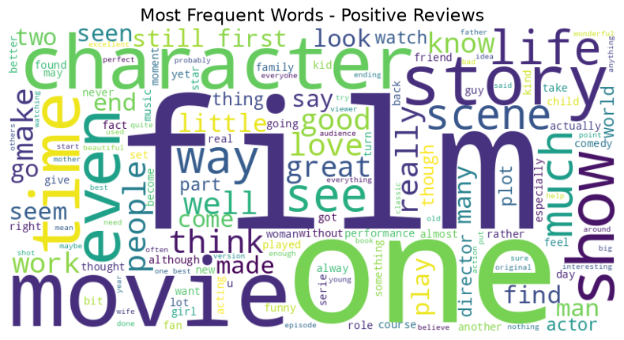
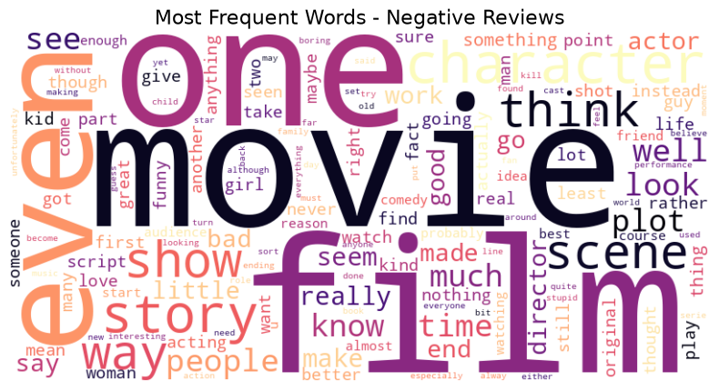

# Sentiment Analysis on Product Reviews

This project implements an end-to-end sentiment analysis pipeline using the IMDB Movie Reviews Dataset. The goal is to classify reviews into positive and negative sentiments using Natural Language Processing (NLP) techniques and Machine Learning classifiers.

---

## Model Evaluation & Results

The dataset of 50,000 reviews was preprocessed (HTML removal, lowercasing, stopword removal, lemmatization) and split into **80% training (40,000 reviews)** and **20% testing (10,000 reviews)**. Text features were extracted using **TF-IDF Vectorization** with a maximum vocabulary size of 10,000 words.

### Performance Comparison

| Model | Training Accuracy | Validation / Test Accuracy | Status |
| :--- | :---: | :---: | :---: |
| **Logistic Regression** | **91.93%** (`0.9193`) | **89.36%** (`0.8936`) |  **Selected (Best)** |
| **Multinomial Naive Bayes** | 87.41% (`0.8741`) | 85.95% (`0.8595`) | Baseline |

- **Best Performing Model**: **Logistic Regression** achieved an accuracy of **89.36%** on unseen test data.
- The model and vectorizer are automatically serialized to `models/sentiment_model.pkl` and `models/tfidf_vectorizer.pkl`.

---

## Exploratory Data Analysis & Visualizations

Word clouds were generated for both positive and negative sentiment classes to highlight the most prominent terms.

### Positive Reviews Word Cloud


*Key positive terms*: `great`, `love`, `good`, `best`, `well`, `story`, `see`, `life`, `character`.

### Negative Reviews Word Cloud


*Key negative terms*: `bad`, `worst`, `even`, `waste`, `terrible`, `boring`, `plot`, `make`, `nothing`.

---

## Project Structure

```text
├── archive/
│   └── IMDB_Dataset.csv          # Raw reviews dataset
├── models/
│   ├── tfidf_vectorizer.pkl      # Saved TF-IDF Vectorizer
│   └── sentiment_model.pkl       # Saved Best Model (Logistic Regression)
├── plots/
│   ├── wordcloud_positive.png    # Word cloud for positive sentiment
│   └── wordcloud_negative.png    # Word cloud for negative sentiment
├── data_preprocess.py            # Text cleaning, lemmatization, and dataset splitting
├── train.py                      # Model training, comparison & selection
├── plots.py                      # Headless word cloud visualization generation
├── main.py                       # Main pipeline orchestration script
├── inference.py                  # Script to run predictions on sample reviews
└── README.md                     # Documentation and results
```

---

## Features

- **Robust Preprocessing Pipeline**: Cleans HTML tags, punctuation, stopwords, and performs lemmatization with NLTK.
- **TF-IDF Feature Extraction**: Converts high-dimensional textual data into 10,000 salient n-gram/word features.
- **Model Comparison**: Automatically evaluates and compares multiple algorithms (`LogisticRegression` vs `MultinomialNB`) on validation data.
- **Headless Visualization**: Generates high-resolution word cloud plots saved directly as PNG files.
- **Inference Pipeline**: Modular inference module for real-time predictions on new review inputs.

---
## Dataset (download and put in archive directory)
https://www.kaggle.com/datasets/lakshmi25npathi/imdb-dataset-of-50k-movie-reviews
---
## How to Run

### 1. Activate Environment
```bash
conda activate sentiment_analysis
# OR
source venv/bin/activate
```

### 2. Train and Evaluate
To run the full end-to-end pipeline (preprocess data, generate word clouds, vectorize, train and save best model):
```bash
python main.py
```

### 3. Run Inference
To test the saved model on sample reviews:
```bash
python inference.py
```